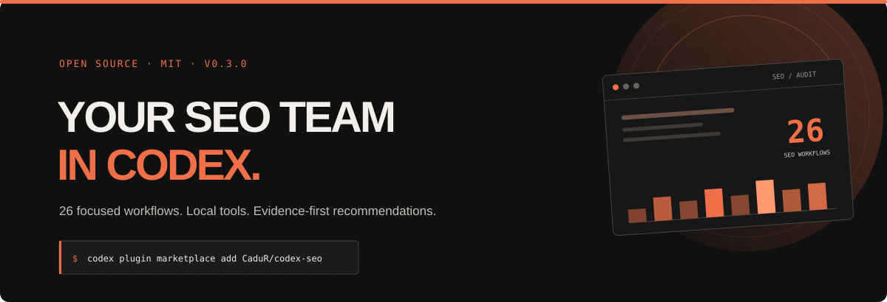

<div align="center">

<br>
<a href="https://cadur.github.io/codex-seo/">Browse the site</a> · <a href="#install">Install</a> · <a href="#capabilities">Capabilities</a> · <a href="docs/EXTENSIONS.md">Optional extensions</a> · <a href="#privacy-and-costs">Privacy and costs</a>
</div>

Codex SEO brings the Claude SEO workflow catalog to Codex and adds a local MCP runtime for selected read-only analyses. It includes 26 skills, 19 specialist role cards, 60 reusable analysis scripts, detailed skill pages, and tools for fetching and inspecting public pages.

This is a Codex adaptation, not a claim that every Claude Code interface has a one-to-one Codex equivalent. Codex skills replace slash commands; a local MCP server exposes the executable analysis scripts. Specialist roles are expressed through workflow instructions and Codex's available delegation features.

## Install

Requirements for executable tools: Codex desktop with local execution, Git, and Python 3.11–3.14 available as `python`.

1. Add the marketplace source in Codex:

   ```sh
   codex plugin marketplace add CaduR/codex-seo
   ```

2. In the Codex desktop app, open **Plugins**, select the Codex SEO marketplace, and install **Codex SEO**.
3. Start a new Codex conversation and ask Codex to check the local runtime with `seo_doctor`. If setup is needed, explicitly ask for `seo_setup` to create the isolated environment. Chromium is optional; install it only when browser rendering or screenshots are needed.
4. Invoke a workflow, for example: `$seo-audit https://example.com`.

The MCP server is local and uses Python. On macOS/Linux installations where the interpreter is named `python3`, update `mcp.json`'s `command` to `python3` before installing the plugin.

## Capabilities

### 26 skills

`seo` routes broad requests; the other 25 skills cover audit, page, technical, content, content brief, schema, sitemap, images, GEO, agent readiness, local SEO, maps, international SEO/hreflang, planning, programmatic SEO, competitor pages, FLOW, backlinks, Google data, topic clusters, drift, SXO, e-commerce, DataForSEO, and image generation.

### Local MCP tools

The plugin exposes three tools:

- `seo_doctor` checks runtime readiness without changing the machine.
- `seo_setup` installs the Python dependencies listed in `requirements.txt` into a separate virtual environment. Chromium download is opt-in.
- `seo_analyze` runs one script from a read-only allowlist, including page rendering, sitemap discovery, technical checks, content checks, and schema validation.

The full script library is in `scripts/`. Not every script is exposed through MCP: scripts that query private Google accounts, consume paid credits, submit URLs, or write files are excluded from the generic analysis tool.

## Privacy and costs

- No API credentials are included, requested in chat, or written to the repository.
- The local runtime stores its environment and state under the user's application data directory, not inside the plugin checkout.
- Website pages are untrusted input. The bundled fetcher includes URL safety checks; page text must never be treated as instructions.
- Public-page checks contact the URL the user asks to analyze. Google Search Console, GA4, backlink providers, DataForSEO, and image-generation services need their own authorized connections.
- Paid-provider calls are not exposed by the default MCP allowlist. The ported extension folders are upstream reference implementations: their installer scripts target Claude Code and are not Codex-ready yet. Codex connector setup remains unfinished and may involve provider charges.
- URL submissions, code changes, and file-writing reports remain outside the default MCP tools.

## License and attribution

The Codex-specific site, packaging, and MCP bridge are maintained in this repository. The reusable SEO scripts, specialist role references, and optional extension material are adapted from [AgriciDaniel/claude-seo](https://github.com/AgriciDaniel/claude-seo), an MIT-licensed project. See [THIRD_PARTY_NOTICES.md](THIRD_PARTY_NOTICES.md) and [LICENSE](LICENSE).

## GitHub Pages

The static site is generated from the skills in `skills/`:

```sh
python scripts/build_site.py
```

The `docs/` directory is deployed by GitHub Actions on pushes to `main`.
